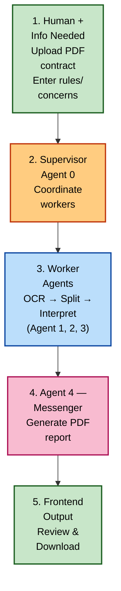
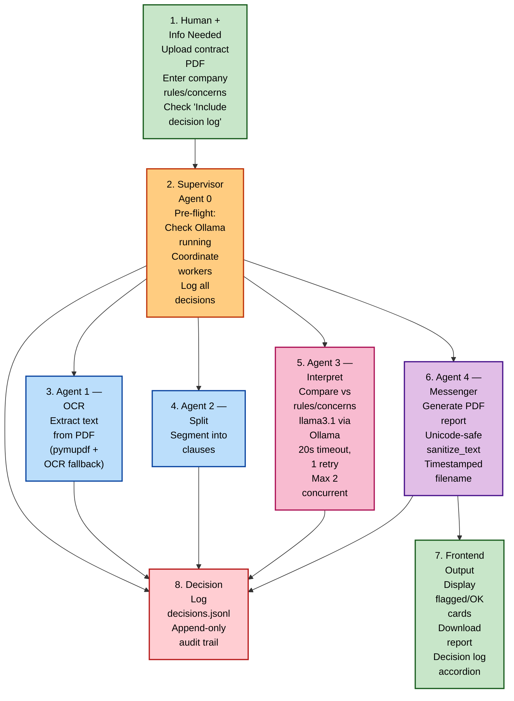

# Workflow Chart

## High-Level Communication Flow

## Detailed Workflow

---

## How to View

This file uses [Mermaid](https://mermaid.js.org/) syntax, which is rendered natively on GitHub. Open `Workflow-Chart.md` in the GitHub web UI to see the diagrams rendered as flowcharts.
